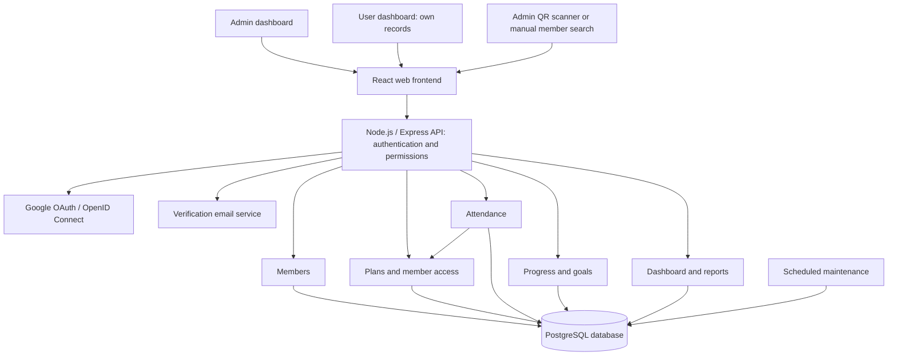

# The Fit District — Fitness Hub Gym Management System

## Scope and architecture

Start with one gym location. Use a responsive web application with exactly two roles, `admin` and `user`, one backend application, and one relational database. The admin manages gym operations; a user is a member accessing their own records. This is a modular monolith: each business area owns its logic, but all modules run together. It keeps deployment and transactional updates simple for the initial system.

The selected stack is **PERN: PostgreSQL, Express, React, and Node.js**. The React frontend is implemented as a local interactive preview in `Frontend`, using Vite and Tailwind CSS. The backend remains a specification. See [frontend setup and preview limitations](Frontend/README.md).

| Layer | Technology and responsibility |
| --- | --- |
| Frontend | React + Tailwind CSS + Vite: admin/user dashboards, forms, charts, and account creation |
| Backend | Node.js + Express: REST API, authentication, RBAC, validation, and business rules |
| Database | PostgreSQL: accounts, access, attendance, session ledger, progress, and audit history |
| Data access | Sequelize models and versioned migrations; transactions for attendance and access updates |
| Security | JWT validation, server-side sessions, Argon2id, Helmet, rate limiting, CSRF protection, and field encryption |
| Identity/email | Google OAuth/OpenID Connect and an email service for account verification codes |

See [Security and account flows](SECURITY.md) and [Backend folder architecture](Backend/ARCHITECTURE.md) for implementation requirements. Sequelize supports versioned migrations and transactions; preserve the database constraints and locking rules in this plan. [Migration documentation](https://sequelize.org/docs/v6/other-topics/migrations/), [transaction documentation](https://sequelize.org/docs/v6/other-topics/transactions/).

An authenticated admin scans a member QR code or searches for a member. A user can display their own QR code on their dashboard. The QR code identifies the member; the backend determines whether they can enter. A QR code does not itself grant access.

## Modules and screens

| Module | Responsibilities | Main screens |
| --- | --- | --- |
| Accounts and authentication | Email/password registration, email-code verification, Google sign-in, sessions, and admin/user permissions | Create account, verify email, sign-in, account settings |
| Members | Member profile, contact details, member number, status | Member list and profile |
| Plans and access | Admin activates memberships, session packs, and day passes; renews access and updates status | Plan catalog, member access history, admin activation form |
| Attendance | Time-in, time-out, current occupants, corrections | Check-in desk, attendance history |
| Progress | Goals, dated measurements, exercise performance | Progress form and charts |
| Reports | Visits, usage, expiring access, and remaining sessions | Admin dashboard |

Recommended member profile tabs: Overview, Access, Attendance, and Progress.

The user dashboard includes their own profile, member QR code, membership status/expiry, remaining sessions, attendance history, progress charts, and goals. The admin dashboard includes member management, access activation, check-in/check-out, exceptions, and gym reports.

## Access products

Keep the plan catalog separate from each member's assigned access. Store the duration/session allowance and admission rules on each access record as a snapshot so later catalog edits do not change existing access.

| Product type | Example | Admission rule |
| --- | --- | --- |
| Membership | One-month unlimited membership | Admin-activated and within its validity period |
| Session pack | Ten gym sessions | Admin-activated, valid, and at least one session available |
| Day pass | One gym visit | Admin-activated, valid, and its one admission unused |

Suggested MVP policy: one successful visit consumes one session; leaving and returning consumes another session. A day pass means one admission. If the gym wants same-day re-entry, specify that separately before implementation.

When several access records are eligible, suggest a valid unlimited membership first; otherwise suggest the session balance that expires soonest. Show the selection to the admin and allow them to choose a different eligible access record.

Renewal creates a new access record and preserves the old history. Allow the admin to choose an immediate start or the end of the current membership. Do not silently overwrite old dates or balances.

## Database model

Use IDs, foreign keys, and database constraints. Store event timestamps in UTC and display them in Asia/Manila. Interpret date-based membership validity in the gym's timezone, then convert its boundaries to UTC. Use an inclusive start and exclusive end boundary.

| Table | Important fields |
| --- | --- |
| `users` | id, name, unique normalized email, password_hash nullable for Google-only accounts, email_verified_at nullable, role constrained to admin/user, enabled |
| `oauth_identities` | id, user_id, provider, provider_subject; unique provider + provider_subject |
| `email_verification_challenges` | id, user_id, purpose, email, code_hmac, expires_at, failed_attempts, consumed_at, created_at |
| `auth_sessions` | id, user_id, created_at, expires_at, revoked_at |
| `refresh_tokens` | id, session_id, unique token_hash, expires_at, consumed_at, replaced_by_id nullable |
| `oauth_transactions` | id, state_hash, nonce_hash, browser_binding_hash, encrypted PKCE verifier, purpose, linking_user_id nullable, expires_at, consumed_at |
| `account_invitations` | id, member_id, invited_email, unique token_hash, issued_by, expires_at, consumed_at |
| `auth_rate_counters` | id, scope, key_hash, window_started_at, count, expires_at; unique scope + key_hash + window |
| `members` | id, user_id unique nullable foreign key to users, unique member number, name, contact details, joined_at, status |
| `plans` | id, name, type, duration rule, session allowance, enabled |
| `access_grants` | id, member_id, plan_id, plan snapshot, valid_from, valid_until, admission_type, status, created_by, activated_by, activated_at |
| `attendance` | id, member_id, access_grant_id, check_in_at, check_out_at, check_in_by, check_out_by, status, unique request key |
| `session_ledger` | id, access_grant_id, attendance_id nullable, signed quantity, reason, reverses_entry_id nullable, created_by, created_at |
| `member_goals` | id, member_id, metric, target_value, unit, target_date, status |
| `progress_assessments` | id, member_id, measured_at, notes, recorded_by |
| `progress_entries` | id, assessment_id, metric, value, unit, exercise_id nullable |
| `exercises` | id, name, measurement convention |
| `audit_events` | id, actor_id, action, entity_type, entity_id, before/after changes, reason, occurred_at |

Relationships:

- Each verified user-role account links to exactly one member profile before member features are available. On verified self-registration, create the member profile transactionally with no active gym access. A member can exist without a login until the admin invites/links their account. Do not link an existing member profile using a client-supplied member ID or matching name/email alone; use an admin-approved, single-use invitation. Admin accounts do not require a member profile.
- A member has many access records, visits, goals, and progress entries.
- A plan has many access records; disabling a plan stops new assignments without cancelling existing access.
- Each visit references the exact access record used to enter.
- Each session-based access record has a ledger: initial allowance `+10`, visit `-1`, reversal `+1`.
- Available sessions are the sum of ledger entries. Unlimited memberships do not need a session ledger.

Essential constraints:

- At most one open attendance record per member, enforced in the database.
- Check-out cannot precede check-in.
- A unique request key makes retried check-ins safe.
- A visit can have only one initial session deduction; an entry can be reversed only once.
- A session-based access record can receive its initial allowance only once, even if activation is retried or access is reactivated after suspension.
- Prevent negative session balances using a transaction that locks the selected access record before checking its ledger and writing a deduction.
- Attendance and access records remain historical records; corrections, status changes, session adjustments, and voids require an audit entry.

## Check-in and check-out

### Check-in

1. The admin scans/searches for the member and confirms their identity.
2. The backend authenticates the admin and checks their attendance permission.
3. Start a database transaction. Lock the member record, check the request key, and check for an existing open visit.
4. If a visit is already open, return “Already checked in” with the original time; do not deduct a session.
5. Check that the member is enabled and the chosen access record is admin-activated and eligible. Lock that access record before checking its remaining balance.
6. Create the visit. For a session pack or day pass, add exactly one `-1` ledger entry.
7. Record the actor and commit all changes together. Return time-in, access used, and remaining sessions when relevant.

All session adjustments must lock the same access record. Keep a consistent lock order, member then access, for operations that need both. Roll back the whole check-in if any required write fails.

### Check-out

1. The admin finds the member's open visit.
2. Set time-out once, using the backend's clock; a retry returns the original result.
3. Derive visit duration from time-out minus time-in. Do not deduct another session.

Check-out remains available after a membership expires or access is suspended because the visit has already started. Use distinct check-in/check-out actions so repeated scans do not immediately check a member out by accident.

### Missing check-outs and corrections

Show unresolved visits in an admin exception list. Flag unusually long visits for review. Do not present an estimated departure time as an observed time. Exclude unresolved visits from average-duration reports and show their count separately.

An admin can correct times or void an erroneous visit with a reason. Voiding an admission charged to a session pack/day pass adds a compensating ledger entry in the same transaction; it does not erase the original deduction. Restrict and audit manual access overrides.

## Counter payment and admin activation

Members pay at the gym counter outside the system. The system manages membership/access status; it does not record payment amounts, methods, receipts, balances due, or financial reports.

Workflow:

1. The member pays at the counter.
2. The admin opens the member profile and selects the membership, session pack, or day pass.
3. The admin sets its validity dates and session allowance when applicable, then activates access.
4. The backend records the access change, admin identity, activation time, and initial session allowance together in one transaction.
5. The member can check in when the access is active, within its validity period, and has sessions remaining if required.

Stored access statuses: `pending`, `active`, `suspended`, and `revoked`. Show `expired` or `sessions exhausted` as effective statuses derived from dates and the session ledger; setting a record to active must not bypass those checks. A future-dated active record is scheduled and cannot be used before its start date.

Only an admin can grant, activate, renew, suspend, revoke, or adjust member access and manage attendance. A user can view their own access status and attendance history. Record every admin status change and allowance adjustment with the actor, timestamp, and reason. Reactivation after suspension preserves existing dates and remaining sessions. Renewal or a new session pack creates a new access record.

## Member progress

Track progress independently of attendance. A visit shows participation; it does not prove a workout or physical improvement.

Initial metrics can include weight, selected body measurements, and exercise performance such as lifted weight and repetitions. Each entry needs a unit and belongs to an assessment carrying its member, date, and author. Link companion exercise metrics to the same assessment when recording a simple performance result; add a dedicated workout/set model when structured workout logging is required.

Display a timeline, charts per metric, starting/latest values, and optional member goals. Compare compatible units and the same exercise convention. Do not combine different metrics into a single “fitness score,” or assume a lower measurement is always better.

Keep progress entry separate so the admin can finish check-in quickly. Admins can record member progress through the member profile. Users can add their own progress entries and manage their own goals; they may edit only progress entries they created. Show who recorded each assessment and retain audit history for corrections.

## Roles and privacy

Exactly two roles: `admin` and `user`. An account's role is separate from its enabled/disabled state and its member's membership status. Expired membership does not prevent an enabled user from signing in to view their history.

| Permission | Admin | User |
| --- | --- | --- |
| Manage accounts and assign roles | Yes | No |
| Create/view/manage member profiles | All members | View own; edit own permitted contact fields |
| Manage plans and activate/renew/update access | Yes | No |
| View membership status and session balance | All members | Own only |
| Record/correct/void check-in and check-out | Yes | No |
| View attendance history | All members | Own only |
| View/add progress | All members | Own only |
| Correct progress | All entries, audited | Own authored entries only, audited |
| Manage goals | All members | Own only |
| View gym-wide reports and audit history | Yes | No |

Enforce role and record ownership in the backend for every request. For user requests, resolve the member from the signed-in account rather than trusting a member ID supplied by the client. Reject attempts to read another member's records or change a role, membership status, dates, or session balance through profile updates. Allowlist fields that users can edit. All admin dashboard routes and operations require the admin role.

Provision the initial admin account through a controlled setup step; only an admin can create/promote other admins. Email/password registration and Google account creation always assign role `user` on the server. Require the app's email verification code for every new account, including new Google registrations, before allowing normal sign-in. Link verified accounts to the correct member profile as described above. Never accept a role selection from an unauthenticated or user-role client. Email verification permits account use; the admin separately activates gym access after counter payment.

Require authentication, protect connections, minimize personal data collected, and keep passwords, credentials, and progress measurements out of routine logs. Protect audit data and database backups; verify restoration before launch.

## Example API boundaries

All endpoints below sit under `/api/v1`. Auth routes have their own validation, CSRF/state protections, and stricter rate limits; business routes require an enabled, verified account and a valid session.

| Action | Endpoint |
| --- | --- |
| Register with email/password | `POST /auth/register` |
| Verify/resend account email code | `POST /auth/verify-email`, `POST /auth/resend-verification` |
| Sign in / refresh / sign out | `POST /auth/login`, `POST /auth/refresh`, `POST /auth/logout` |
| Begin/complete Google sign-in | `GET /auth/google`, `GET /auth/google/callback` |
| Link Google to an existing account | `POST /auth/google/link`, then the bound OAuth callback |
| Read current account / obtain CSRF token | `GET /auth/me`, `GET /auth/csrf` |
| Admin manages accounts | `POST /users`, `PATCH /users/{id}` |
| Admin creates/searches members | `POST /members`, `GET /members` |
| Admin views/updates member profile | `GET/PATCH /members/{id}` |
| Admin invites an existing member to create/link an account | `POST /members/{id}/account-invitations` |
| User views/updates own profile | `GET/PATCH /me/member` |
| Admin manages plan catalog | `GET/POST /plans`, `PATCH /plans/{id}` |
| Admin assigns/renews access | `POST /members/{id}/access-grants` |
| Admin activates access | `POST /access-grants/{id}/activate` |
| Admin updates access status/dates | `PATCH /access-grants/{id}` |
| Admin adjusts session allowance | `POST /access-grants/{id}/session-adjustments` |
| Admin views member access/balances | `GET /members/{id}/access` |
| User views own access/balances | `GET /me/access` |
| Admin checks in / out | `POST /attendance/check-ins`, `POST /attendance/{id}/check-out` |
| Admin lists visits / current occupants | `GET /attendance`, `GET /attendance/open` |
| User views own attendance | `GET /me/attendance` |
| Admin corrects / voids visit | `PATCH /attendance/{id}`, `POST /attendance/{id}/void` |
| Admin records / views member progress | `POST/GET /members/{id}/progress`, `PATCH /progress/{id}` |
| User records / views own progress | `POST/GET /me/progress`, `PATCH /me/progress/{id}` |
| Admin manages member goals | `POST/GET /members/{id}/goals`, `PATCH /goals/{id}` |
| User manages own goals | `POST/GET /me/goals`, `PATCH /me/goals/{id}` |
| Admin dashboard | `GET /reports/summary` |

Use request keys for retryable access creation, activation, session adjustments, and check-in mutations. Return clear reasons such as pending admin activation, expired access, suspended member/access, revoked access, or no sessions available. Balance validation and deduction always happen on the backend.

## Dashboard definitions

- **Members currently inside:** visits with time-in and no time-out.
- **Today's visits:** successful, non-void check-ins during the gym's local day.
- **Unique visitors:** distinct members among those visits; returning visits are not new people.
- **Members with valid access:** enabled members with at least one admin-activated, currently valid access record; session-based access must have a positive balance.
- **Pending activation:** access records awaiting admin activation.
- **Expiring memberships:** membership access ending within a selected window.
- **Low session balances:** valid session access below an admin-selected threshold.
- **Average visit duration:** completed, non-void visits only, with missing check-outs identified separately.

Use attendance event times and ledger balances as the source of truth. Do not rely on scheduled jobs to make expiry accurate; admission checks evaluate validity at the time of each request. Jobs can flag exceptions and support reminders later.

## Build order and acceptance checks

1. PERN foundation, migrations, security middleware, email/password registration, Google sign-in, email verification, JWT/session handling, and admin/user permissions.
2. Linked member accounts, plan catalog, and admin-managed access activation/renewal/status changes.
3. Attendance and session ledger, then the admin dashboard and exception handling; show each user their own access and visits.
4. Progress entries, goals, and charts in both dashboards with ownership checks.
5. Reports, backups, audit review, automated security tests, Postman checks, and staging ZAP scans.

Before launch, verify simultaneous/repeated scans consume one session, the final session cannot be spent twice, expiry uses Manila day boundaries, membership renewal preserves history, check-out works after expiry, voiding restores a charged session once, activation retries/reactivation cannot duplicate session credit, pending/suspended/revoked access cannot admit a member, and only an admin can update access status or session allowances. Verify users cannot access another member's data, overwrite admin-authored progress, record attendance, or promote themselves to admin, including through direct API requests.

Also verify email-code expiry/reuse/attempt limits, new accounts cannot bypass verification through Google, Google callback replay/state validation, safe account linking, JWT validation, refresh-token reuse detection, logout revocation, CSRF protection, rate limiting, input validation, security headers, and errors that conceal internal details. Detailed test requirements are in [SECURITY.md](SECURITY.md).

Optional later additions: reminders, structured workouts, class scheduling, and multiple branches. When branches are needed, add locations and explicit access scope; define whether balances and memberships work across branches before migrating.
