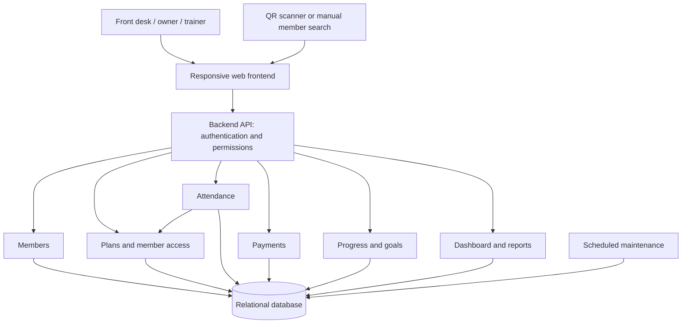

# The FitnessDistrict — Gym Management System

## Scope and architecture

Start with one gym location. Use a responsive web application for the front desk, owner, and trainers, one backend application, and one relational database. This is a modular monolith: each business area owns its logic, but all modules run together. It keeps deployment and transactional updates simple for the initial system.

The existing `Frontend` and `Backend` folders are empty, so this design does not assume a framework or an existing implementation.

An authenticated front-desk operator scans a member QR code or searches for a member. The QR code identifies the member; the backend determines whether they can enter. A QR code does not itself grant access.

## Modules and screens

| Module | Responsibilities | Main screens |
| --- | --- | --- |
| Members | Member profile, contact details, member number, status | Member list and profile |
| Plans and access | Sell memberships, session packs, and day passes; renew, expire, suspend | Plan catalog, member access history |
| Attendance | Time-in, time-out, current occupants, corrections | Check-in desk, attendance history |
| Payments | Record payments, references, and activation eligibility | Payment form, payment history |
| Progress | Goals, dated measurements, exercise performance | Progress form and charts |
| Reports | Visits, usage, expiring access, recorded payments | Owner dashboard |

Recommended member profile tabs: Overview, Access, Attendance, Payments, and Progress.

## Access products

Keep the product catalog separate from the access a member purchases. Store the price, duration/session allowance, and admission rules on each purchase as a snapshot so later catalog edits do not change old purchases.

| Product type | Example | Admission rule |
| --- | --- | --- |
| Membership | One-month unlimited membership | Paid/approved, enabled, and within its validity period |
| Session pack | Ten gym sessions | Paid/approved, enabled, valid, and at least one session available |
| Day pass | One gym visit | Paid/approved, enabled, valid, and its one admission unused |

Suggested MVP policy: one successful visit consumes one session; leaving and returning consumes another session. A day pass means one admission. If the gym wants same-day re-entry, specify that separately before implementation.

When several purchases are eligible, suggest a valid unlimited membership first; otherwise suggest the session balance that expires soonest. Show the selection to staff and allow them to choose a different eligible purchase.

Renewal creates a new access record and preserves the old history. Allow staff to choose an immediate start or the end of the current membership. Do not silently overwrite old dates or balances.

## Database model

Use IDs, foreign keys, and database constraints. Store event timestamps in UTC and display them in Asia/Manila. Interpret date-based membership validity in the gym's timezone, then convert its boundaries to UTC. Use an inclusive start and exclusive end boundary.

| Table | Important fields |
| --- | --- |
| `users` | id, name, login identifier, password hash, role, enabled |
| `members` | id, unique member number, name, contact details, joined_at, status |
| `plans` | id, name, type, price, duration rule, session allowance, enabled |
| `access_grants` | id, member_id, plan_id, product snapshot, valid_from, valid_until, admission_type, enabled, activation_status |
| `attendance` | id, member_id, access_grant_id, check_in_at, check_out_at, check_in_by, check_out_by, status, unique request key |
| `session_ledger` | id, access_grant_id, attendance_id nullable, signed quantity, reason, reverses_entry_id nullable, created_by, created_at |
| `payments` | id, member_id, access_grant_id, amount, currency, method, reference, status, paid_at, recorded_by |
| `member_goals` | id, member_id, metric, target_value, unit, target_date, status |
| `progress_assessments` | id, member_id, measured_at, notes, recorded_by |
| `progress_entries` | id, assessment_id, metric, value, unit, exercise_id nullable |
| `exercises` | id, name, measurement convention |
| `trainer_assignments` | id, trainer_user_id, member_id, assigned_at, ended_at nullable |
| `audit_events` | id, actor_id, action, entity_type, entity_id, before/after changes, reason, occurred_at |

Relationships:

- A member has many access purchases, visits, payments, goals, and progress entries.
- A plan has many access purchases; disabling a plan stops new sales without cancelling existing access.
- Each visit references the exact access purchase used to enter.
- Each session-based purchase has a ledger: purchase `+10`, visit `-1`, reversal `+1`.
- Available sessions are the sum of ledger entries. Unlimited memberships do not need a session ledger.

Essential constraints:

- At most one open attendance record per member, enforced in the database.
- Check-out cannot precede check-in.
- A unique request key makes retried check-ins safe.
- A visit can have only one initial session deduction; an entry can be reversed only once.
- Prevent negative session balances using a transaction that locks the selected access record before checking its ledger and writing a deduction.
- Attendance and payment records remain historical records; corrections and voids require an audit entry.
- Money uses exact decimal values and an explicit currency.

## Check-in and check-out

### Check-in

1. Staff scans/searches for the member and confirms their identity.
2. The backend authenticates staff and checks their attendance permission.
3. Start a database transaction. Lock the member record, check the request key, and check for an existing open visit.
4. If a visit is already open, return “Already checked in” with the original time; do not deduct a session.
5. Check that the member is enabled and the chosen access purchase is eligible. Lock that access record before checking its remaining balance.
6. Create the visit. For a session pack or day pass, add exactly one `-1` ledger entry.
7. Record the actor and commit all changes together. Return time-in, access used, and remaining sessions when relevant.

All session adjustments must lock the same access record. Keep a consistent lock order, member then access, for operations that need both. Roll back the whole check-in if any required write fails.

### Check-out

1. Staff finds the member's open visit.
2. Set time-out once, using the backend's clock; a retry returns the original result.
3. Derive visit duration from time-out minus time-in. Do not deduct another session.

Check-out remains available after a membership expires or access is suspended because the visit has already started. Use distinct check-in/check-out actions so repeated scans do not immediately check a member out by accident.

### Missing check-outs and corrections

Show unresolved visits in a front-desk exception list. Flag unusually long visits for review. Do not present an estimated departure time as an observed time. Exclude unresolved visits from average-duration reports and show their count separately.

An owner can correct times or void an erroneous visit with a reason. Voiding an admission charged to a session pack/day pass adds a compensating ledger entry in the same transaction; it does not erase the original deduction. Restrict and audit manual access overrides.

## Payments and activation

For the MVP, record cash/manual payments and a receipt or transaction reference. Payment recording is distinct from online payment processing.

A purchase is admitted only after its activation rule is satisfied. By default require payment to be marked paid; an owner may approve an exception with a recorded reason. Record a paid purchase, its initial session credit if applicable, and activation together in one transaction.

Payment status and access status are separate. A refund or payment reversal requires an explicit access decision and must preserve the payment and attendance history. Refund handling can be a later feature if the initial system only records sales.

## Member progress

Track progress independently of attendance. A visit shows participation; it does not prove a workout or physical improvement.

Initial metrics can include weight, selected body measurements, and exercise performance such as lifted weight and repetitions. Each entry needs a unit and belongs to an assessment carrying its member, date, and author. Link companion exercise metrics to the same assessment when recording a simple performance result; add a dedicated workout/set model when structured workout logging is required.

Display a timeline, charts per metric, starting/latest values, and optional member goals. Compare compatible units and the same exercise convention. Do not combine different metrics into a single “fitness score,” or assume a lower measurement is always better.

Keep progress entry optional so reception can finish check-in quickly. Trainers can record progress through the member profile. Allow corrections with audit history.

## Roles and privacy

| Role | Access |
| --- | --- |
| Owner/admin | Plans, staff accounts, purchases, payments, corrections, reports, and progress |
| Front desk | Member lookup, purchases/payment recording, and attendance; no progress measurements by default |
| Trainer | Assigned members' progress and relevant attendance; no payment or staff administration |
| Member — optional later | Own access balance, visits, goals, and progress |

Enforce these rules in the backend for every request. Add trainer/member assignments before enabling restricted trainer access. Require staff authentication, protect connections, minimize personal data collected, and keep passwords, credentials, and progress measurements out of routine logs. Protect audit data and database backups; verify restoration before launch.

## Example API boundaries

| Action | Endpoint |
| --- | --- |
| Create/search members | `POST /members`, `GET /members` |
| View member profile | `GET /members/{id}` |
| Manage plan catalog | `GET/POST /plans`, `PATCH /plans/{id}` |
| Purchase/renew access | `POST /members/{id}/access-grants` |
| Record payment | `POST /access-grants/{id}/payments` |
| View valid access/balances | `GET /members/{id}/access` |
| Check in / out | `POST /attendance/check-ins`, `POST /attendance/{id}/check-out` |
| List visits / current occupants | `GET /attendance`, `GET /attendance/open` |
| Correct / void visit | `PATCH /attendance/{id}`, `POST /attendance/{id}/void` |
| Record / view progress | `POST/GET /members/{id}/progress` |
| Manage goals | `POST/GET /members/{id}/goals`, `PATCH /goals/{id}` |
| Owner dashboard | `GET /reports/summary` |

Use request keys for retryable purchase/payment/check-in mutations. Return clear reasons such as expired access, unpaid purchase, suspended member, or no sessions available. Balance validation and deduction always happen on the backend.

## Dashboard definitions

- **Members currently inside:** visits with time-in and no time-out.
- **Today's visits:** successful, non-void check-ins during the gym's local day.
- **Unique visitors:** distinct members among those visits; returning visits are not new people.
- **Members with valid access:** enabled members with at least one activated, currently valid access purchase; session-based purchases must have a positive balance.
- **Expiring memberships:** membership purchases ending within a selected window.
- **Low session balances:** valid session purchases below an owner-selected threshold.
- **Recorded payment totals:** paid records within the selected period, with any reversals/refunds reported separately if implemented.
- **Average visit duration:** completed, non-void visits only, with missing check-outs identified separately.

Use attendance event times and ledger balances as the source of truth. Do not rely on scheduled jobs to make expiry accurate; admission checks evaluate validity at the time of each request. Jobs can flag exceptions and support reminders later.

## Build order and acceptance checks

1. Staff login and permissions, members, plan catalog, access purchases, and manual payments.
2. Attendance and session ledger, then the front-desk dashboard and exception handling.
3. Progress entries, goals, charts, and trainer assignments.
4. Reports, backups, audit review, and launch verification.

Before launch, verify simultaneous/repeated scans consume one session, the final session cannot be spent twice, expiry uses Manila day boundaries, membership renewal preserves history, check-out works after expiry, voiding restores a charged session once, and each role can access only authorized records.

Optional later additions: member portal, payment gateway, reminders, structured workouts, class scheduling, and multiple branches. When branches are needed, add locations and explicit access scope; define whether balances and memberships work across branches before migrating.
